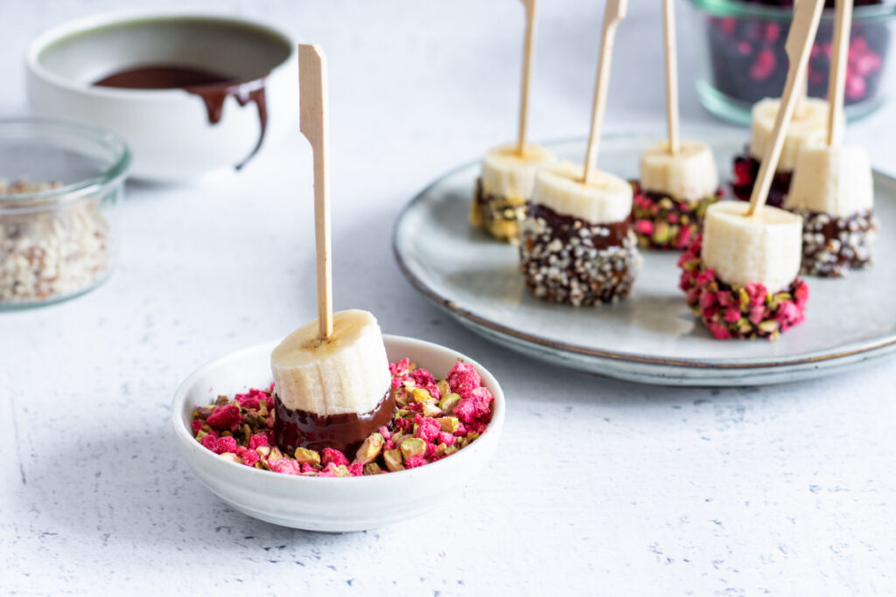

# ukol1
## Banány jsou A tier
Vestavěný obal *(Easy to Peel)*: Banán má vlastní biologický obal, který funguje jako perfektní ochrana před špínou. Nepotřebuješ žádné nádobí ani nůž – stačí ho jednoduše oloupat rukama kdekoliv na cestách.
Skvělý zdroj energie: Je plný přírodních cukrů a sacharidů, takže ti rychle dodá energii. Proto je tak oblíbený u sportovců před tréninkem nebo během něj.
Vitamíny a minerály: Obsahuje spoustu draslíku *(který pomáhá proti svalovým křečím)*, vitamín B6, vitamín C a vlákninu, takže **prospívá celkovému zdraví i trávení**.
Univerzálnost v kuchyni: Skvěle chutná sám o sobě, ale naprosto dominuje v smoothies, ovesných kaších, na palačinkách nebo jako základ pro domácí banánový chlebíček či zmrzlinu.
Skvělý poměr ceny a výkonu: V obchodech je **cenově dostupný** a navíc v supermarketech většinou nestojí majlant.

Navštivte pro[více informací o banánech.](https://cs.wikipedia.org/wiki/Ban%C3%A1n) 

Více se dozvíte v [Recept](https://www.toprecepty.cz/recept/5843-banan-v-cokolade/)
